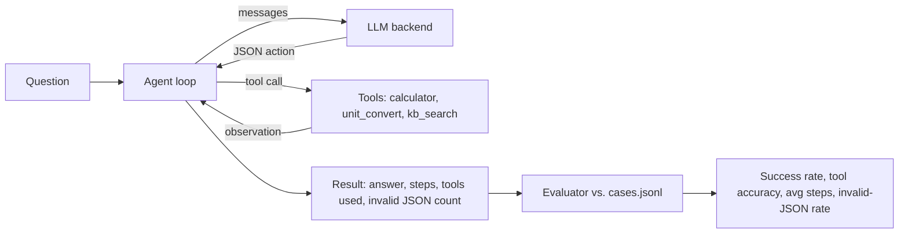

# agent-eval-lab: A Tool-Using LLM Agent and Its Evaluation Harness

[](https://github.com/poojabhather99/agent-eval-lab/actions/workflows/ci.yml)


A small, dependency-light implementation of a ReAct-style agent (the model reasons, calls a tool, reads the observation, repeats) together with an evaluation harness that measures whether the agent actually gets tasks right. The point of the project is the second half: **agents should be measured, not eyeballed.**

The harness runs offline with a deterministic baseline policy, so CI needs no API key. Point it at a real model (Groq's Llama 3.3 70B is wired in) to compare.

## How it works



- **Protocol:** every model reply must be one JSON object, either `{"action": ..., "input": {...}}` or `{"final": ...}`. Replies are parsed tolerantly (code fences and surrounding prose are fine). Invalid replies are counted and the model is told to retry.
- **Safety limits:** a maximum step count stops runaway loops; the calculator uses an AST allow-list instead of `eval`, caps exponents, and returns errors as observations the model can recover from.
- **Backends:** `GroqLLM` (real model), `HeuristicLLM` (single-step rule-based baseline), `ScriptedLLM` (fixed replies for tests). Any object with `complete(messages) -> str` works.

## Metrics

| Metric | Meaning |
|---|---|
| Success rate | Final answer contains the expected value (numeric tolerance or substring) |
| Tool-selection accuracy | The set of tools used equals the expected set for the task |
| Average steps | Model calls per task (lower is more efficient) |
| Invalid-JSON rate | Share of steps where the model broke the output protocol |

The 15 cases in `evals/cases.jsonl` cover arithmetic, unit conversion, handbook lookups, and **multi-step tasks that need two tools in sequence** (for example, look up annual leave days, then convert to weeks).

## Baseline results

Run with the offline heuristic policy (`python -m agentlab.evaluate --llm heuristic`):

| Metric | Heuristic baseline |
|---|---|
| Success rate | 0.667 (10 of 15) |
| Tool-selection accuracy | 0.667 |
| Average steps | 2.0 |
| Invalid-JSON rate | 0.0 |

The baseline passes every single-tool task except "square root of 144" (its router does not recognise the phrasing) and fails all four multi-step tasks because it can only call one tool. That is the intended floor: a useful agent has to beat it by chaining tools. I have not included results for a real model in this repo; run `--llm groq` with your own key to produce them.

## Usage

```bash
git clone https://github.com/poojabhather99/agent-eval-lab.git
cd agent-eval-lab
python -m venv .venv && source .venv/bin/activate
pip install -r requirements-dev.txt
export PYTHONPATH=src

python -m pytest                                   # unit tests
python -m agentlab.evaluate --llm heuristic        # offline baseline

export GROQ_API_KEY=...                            # evaluate a real model
python -m agentlab.evaluate --llm groq --model llama-3.3-70b-versatile
```

Each run writes a per-case report to `reports/<backend>.json`.

## Project structure

```
src/agentlab/agent.py     agent loop, JSON action parsing, trace
src/agentlab/tools.py     calculator, unit_convert, kb_search and the tool runner
src/agentlab/kb.py        synthetic company handbook and keyword search
src/agentlab/llm.py       Groq, heuristic baseline and scripted backends
src/agentlab/evaluate.py  scoring, metrics and CLI
evals/cases.jsonl         evaluation cases
tests/                    unit tests for tools, parsing, loop control and scoring
```

## Limitations and next steps

- Scoring is lenient: a numeric case passes if any number in the answer matches, so a verbose answer can pass by luck. An LLM or stricter extractor would tighten this.
- 15 cases is enough to demonstrate the harness, not to rank models; extend `cases.jsonl` for real comparisons.
- Next: run each case several times to measure variance, record token cost and latency per task, and add adversarial cases (ambiguous questions, tool errors, missing information).

## License

MIT
